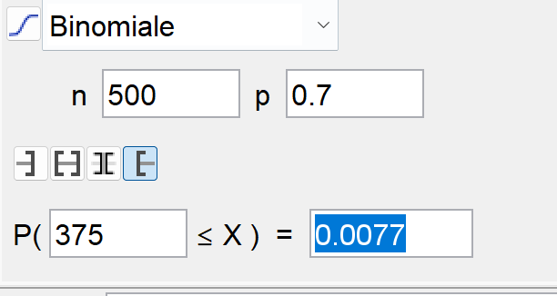
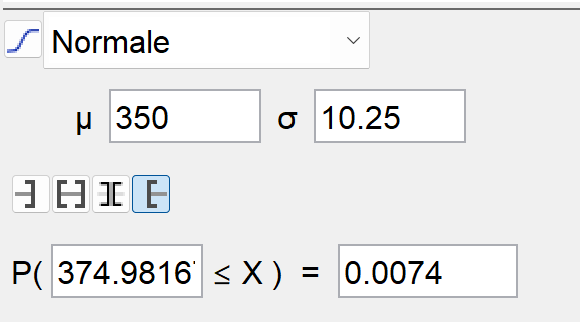
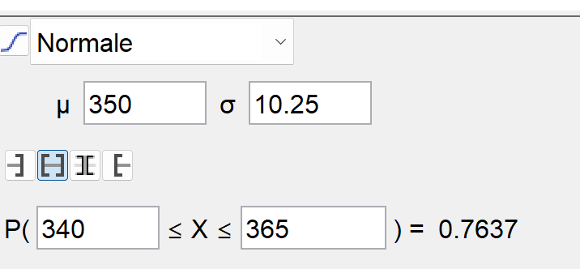

# Exercice 1

1. a. Montrer que X suit une loi binomiale de paramètres n et p.

- "Expédier une lettre" est une expérience aléatoire à 2 issues:
    > succès $S$: la lettre est parvient à leur destinataire le lendemain de probabilite $p=0.7$\
    > échec $\bar{S}$: la lettre n'est pas parvient à leur destinataire le lendemain de probabilite $q=1-p=0.3$
- On répète cette expérience $n=500$ fois de manière identique et indépendante. 
- On note $X$ le nombre de succès (lettres parvenues à leur destinataire le lendemain) sur les $n$ expériences.
- Ainsi, $X$ suit une loi binomiale de paramètres $n=500$ et $p=0.7$.

2. $P_0 = P(X \geq 375) = 0.0077$

3. a. On a $n=500 $ et $p=0.7$. On a donc $np(1-p)=500*0.7*0.3=105$. Puisque $np(1-p) \geq 10$, on peut donc utiliser l'approximation par la loi normale.

Cette loi normale a pour espérance $\mu = np = 500*0.7=350$ et pour écart-type $\sigma = \sqrt{np(1-p)} = \sqrt{105} \approx 10.25$.

3. b. $P'(0) = P( Y \geq 375) = 0.0074 $.

4. $P(340<Y<365) = P(340<Y<365) = 0.7637$

